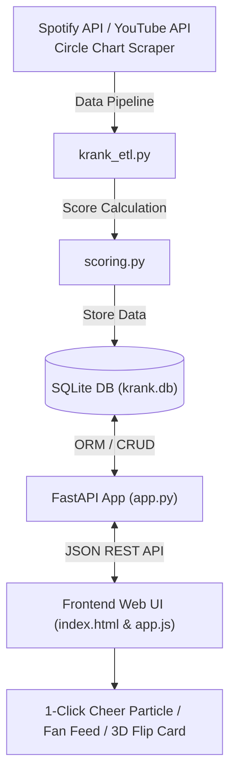

# ⚙️ K-Rank (케이랭크) 시스템 아키텍처 및 API/DB 스펙 명세서

> **프로젝트명:** K-Rank MVP  
> **문서 버전:** v1.0.0  
> **작성일:** 2026-11-11  
> **기술 스택:** Python 3.10+ | FastAPI | SQLite3 | TailwindCSS | Chart.js  
> **저장 경로:** `01_Biz_Projects/krank/K_Rank_시스템_아키텍처_및_스펙_명세서.md`  

---

## 1. 시스템 아키텍처 (System Architecture)



---

## 2. 데이터베이스 스키마 명세 (Database Schema - `krank.db`)

### `artists` (아티스트 마스터 테이블)
- `id` (INTEGER, PK, AUTOINCREMENT): 아티스트 고유 식별자
- `name` (TEXT, NOT NULL): 그룹/아티스트 명 (예: "방탄소년단", "뉴진스")
- `name_en` (TEXT, NOT NULL): 영문 아티스트 명 (예: "BTS", "NewJeans")
- `agency` (TEXT): 소속사 (예: "하이브/빅히트", "어도어")
- `debut_year` (INTEGER): 데뷔 년도
- `photo_url` (TEXT): 공식 고화질 사진 URL
- `avatar_url` (TEXT): 정교한 2D/3D 스타일 캐리커쳐 아바타 URL
- `kscore` (REAL, DEFAULT 0.0): 종합 K-Score (100점 만점)
- `tier` (TEXT): 등급 (`S+`, `S`, `A`, `B`, `C`)
- `cheer_count` (INTEGER, DEFAULT 0): 실시간 1클릭 하트 응원 수
- `fandom_name` (TEXT): 팬덤명 (예: "아미", "버니즈")
- `signature_quote` (TEXT): 팬들에게 전하는 아티스트 명언/어록
- `tags_json` (TEXT): 시그니처 해시태그 (JSON 문자열)
- `metrics_json` (TEXT): 6대 정량 지표 세부 점수 (JSON 문자열)
- `updated_at` (TEXT): 최신 데이터 업데이트 일시

### `cheer_logs` (실시간 응원 이력)
- `id` (INTEGER, PK): 로그 ID
- `artist_id` (INTEGER, FK): 아티스트 ID
- `ip_hash` (TEXT): 어뷰징 방지용 익명화 IP 식별자
- `created_at` (TEXT): 응원 시간

### `fan_discussions` (시민/팬덤 한줄 토론 피드)
- `id` (INTEGER, PK): 피드 ID
- `artist_id` (INTEGER, FK): 아티스트 ID
- `stance` (TEXT): 스탠스 (`💖 응원`, `🎵 입덕`, `🔥 화력지원`)
- `author` (TEXT): 익명 닉네임
- `content` (TEXT): 토론 내용
- `created_at` (TEXT): 작성 시간

---

## 3. 핵심 REST API 엔드포인트 명세 (API Endpoints)

| Method | Endpoint | 설명 |
| :--- | :--- | :--- |
| `GET` | `/api/artists` | 전체 아티스트 랭킹 목록 및 K-Score 조회 (정렬: K-Score 내림차순) |
| `GET` | `/api/artists/{id}` | 특정 아티스트 상세 정보 및 6축 레이더 데이터 조회 |
| `POST` | `/api/artists/{id}/cheer` | 1클릭 하트 응원 등록 및 하트 수 실시간 증가 |
| `GET` | `/api/artists/{id}/discussions` | 아티스트 팬덤 토론 피드 목록 조회 |
| `POST` | `/api/artists/{id}/discussions` | 한줄 토론 작성 등록 |

---

## 4. 디렉터리 및 코드 구조 설계 (`01_Biz_Projects/krank_mvp/`)

```text
01_Biz_Projects/krank_mvp/
├── app.py                   # FastAPI 메인 웹 서버 & REST API 라우터
├── database.py              # SQLite DB 연결, 스키마 생성 및 ORM 쿼리
├── scoring.py               # K-Score 6대 지표 산출 및 티어 계산 알고리즘
├── run.py                   # Uvicorn 백엔드 서버 구동 스크립트
├── seed_data.json           # Top 32 K-Pop 아티스트 초기 시드 데이터
├── krank.db                 # SQLite 데이터베이스 파일
├── requirements.txt         # 파이썬 의존성 패키지 (fastapi, uvicorn 등)
└── static/                  # 프론트엔드 정적 파일
    ├── index.html           # 메인 대시보드 웹 페이지
    ├── app.js               # 6축 레이더 차트, 3D 플립 카드, 하트 파티클 UI
    └── style.css            # TailwindCSS 및 커스텀 애니메이션 스타일
```
